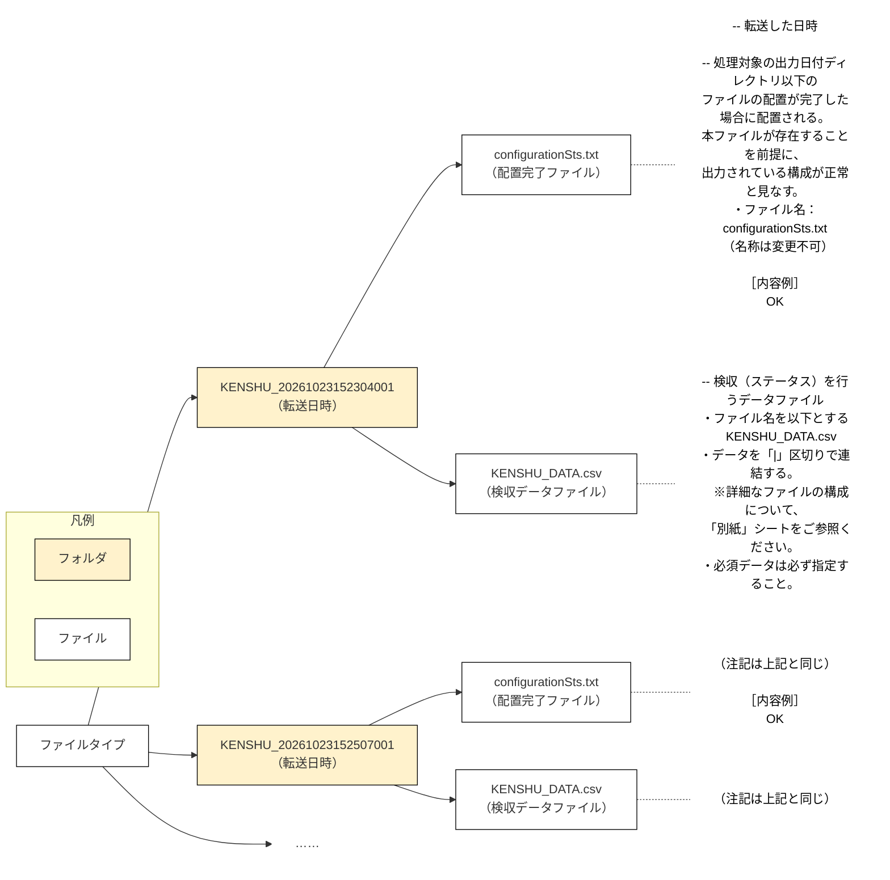

> モデル：老师の「ファイルタイプ」図（tes.png）
> 老師：転送日時フォルダ（HINBAN_YYYYMMDDhhmmssSSS）に 配置完了ファイル＋品番情報データファイル
> 科：KENSHU_ プレフィックスの転送日時フォルダに 配置完了ファイル＋検収データファイル（2例＋……）



---

## フォルダ内の構成（テキスト版）

```
KENSHU_20261023152304001/          ← 転送日時フォルダ
├── configurationSts.txt           ← 配置完了ファイル（内容："OK"／名称変更不可）
└── KENSHU_DATA.csv                ← 検収データファイル（「|」区切り）

KENSHU_20261023152507001/          ← 2つ目以降も同構成
├── configurationSts.txt
└── KENSHU_DATA.csv
……
```

---

## メモ

- フォルダ名は「KENSHU_YYYYMMDDhhmmssSSS」（処理補足 3.① と整合）
- 配置完了ファイル configurationSts.txt は**名称変更不可**、内容が「OK」のもののみ処理処理対象（処理補足 3.② と整合）
- データファイルの詳細な項目構成は「別紙：ファイルの構成」シート参照（8項目を「|」で結合）
- 老師の図は1つのフォルダごとに全注記を書き写しているが、2つ目以降は「注記は上記と同じ」に省略可（Excelに貼る際は老师に合わせて展開してもよい）
- KENSHU_ プレフィックス・configurationSts.txt の実名称はTMKとの合意結果で確定
