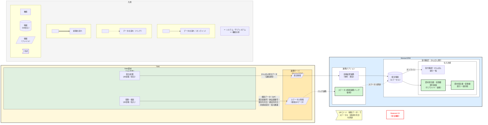

# システム間I/F機能関連図

| 項目 | 内容 |
|---|---|
| プロジェクト名 | トク九州 |
| システム名/サブシステム名 | Meister SRM／資材 |
| 図名 | システム間I/F機能関連図〔かんばん発注～納入～検収（No19/No22）〕 |

> 参考図のうち、担当範囲（かんばん発注情報の連携、ステータス（検収）情報の連携、資材発注書・受領書発行画面／一括印刷）のみを記載。

## 補足（参考図との対応）

| 参考図（No19/No22） | 本図での表現 |
|---|---|
| TMK資材：発注処理 → 連携サーバ：発注情報 | 機能「発注処理」→ 情報「発注情報（ファイル）」 |
| MeisterSRM：自動起票連携 → 発注情報 → 受付確認・かんばん発行一覧 | 機能「自動起票連携（参考・既存）」→ 情報「発注情報（DB）」→ 機能「受付確認・かんばん発行一覧」 |
| 受領・検収（QR読取）→ ステータス情報 → ステータス情報連携 | 機能「受領・検収」→ 情報「ステータス情報（検収QRデータ・ファイル）」→ 機能「ステータス情報連携バッチ（新規）」（バッチ＝破線） |
| 検収ファイルのQR項目 | データフローのラベルに記載（発注書番号・納品書番号・発注年月日・検収年月日・未検収区分・受入数量） |
| 資材発注書・受領書発行一覧／一括印刷 | 担当機能「資材発注書・受領書発行画面（新規）」「一括印刷」 |

## 担当機能（図中の緑色枠）

1. **受付確認・かんばん発行 ステータス情報連携バッチ**（連携オプション／新規）
   - 情報取得処理、データ登録・更新処理、DB新規
2. **資材発注書・受領書発行画面（サプライヤ）**
   - 画面の新規、検索条件を追加、一覧項目を追加、検索処理を追加
3. **資材発注書・受領書発行 一括印刷**
   - テンプレート作成処理、選択した案件を印刷チェック状態にする処理、データ取得処理、EXCEL出力処理、ZIP圧縮処理、ダウンロード処理、一括印刷処理
